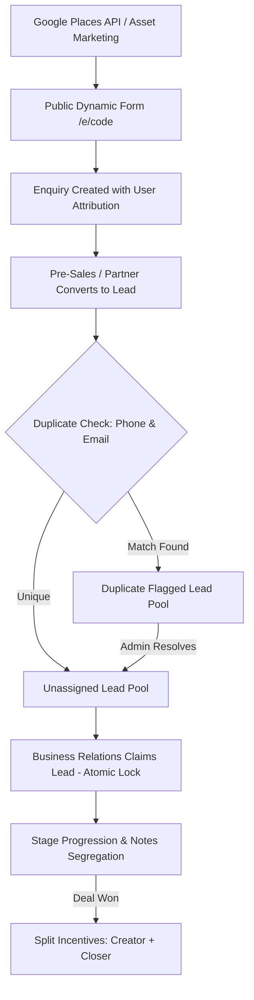

# Schoolites - Project Specification & Architecture Reference Document

## 1. Project Overview & True Scope
**Schoolites** is a specialized B2B Enterprise CRM and Multi-Actor Business Development Portal for educational software / ERP sales targeting educational institutions (Schools, Colleges, Universities, and Educational Organizations).

It is **NOT** an open educator monetization platform (that was an unrelated workspace rule from another project). 
Instead, Schoolites is a structured, production-grade B2B sales engine designed to acquire educational institutions through a coordinated pipeline of Pre-Sales outreach, Referral Partners, and Business Relations closers.

---

## 2. Actors & Role Responsibilities

### Actor 1: Root Administrator
* **User Management:** Create, deactivate, and monitor users across all 3 teams with sequential unique codes (`ADM-101`, `PS-102`, `REF-103`, `BR-104`).
* **Dynamic Form Configurator:** Toggle fields between Required, Optional, or Hidden for both Enquiry Forms and Lead Forms without code deploys.
* **Asset Hub:** Create and curate promotional assets (text, images, PDFs, video links) for marketing campaigns.
* **Incentive & Commission Governance:** Manage default payout rates (Pre-Sales 10%, Referral Partner 20%, Business Relations 10%), approve invoices, and record payouts with UTR/Transaction Reference IDs.
* **Lead Pool Oversight & Duplicate Resolution:** Central visibility into all leads, reassignment authority, and duplicate flag clearing.
* **Audit & Compliance Logs:** Full immutable audit trail recording every login, status change, claim, and administrative action.
* **Places Data Staging:** Execute Google Places API (New) searches and release curated batches to teams.

### Actor 2: Pre-Sales Team (`PS-xxx`)
* **Outreach & Unique Links:** Access marketing assets with unique shareable links (`/e/PS-xxx`) to drive organic institute enquiries.
* **Enquiry Management:** Access incoming enquiries submitted through their unique links.
* **Lead Conversion:** Qualify prospects and convert validated enquiries into official Leads in the unassigned pool.
* **Direct Lead Creation:** Enter qualified leads with full SPOC and Decision Maker information.
* **Incentive Tracking:** Track earned and pending 10% incentives upon deal closure by Business Relations.

### Actor 3: Referral Partner (`REF-xxx`)
* **Partner Hub & Unique Links:** Dedicated workspace with personal referral link (`/e/REF-xxx`).
* **Lead Submission:** Submit direct institute referrals.
* **Commission Tracking:** Track 20% commission rates on closed business.
* **Invoice Submission:** View pending/cleared commissions and submit billing invoices for Admin payment clearance.

### Actor 4: Business Relations Team (`BR-xxx`)
* **Unassigned Leads Pool:** Browse new leads created by Pre-Sales and Referral Partners.
* **Atomic Lead Claiming ("Grab"):** First-come-first-served atomic claim mechanism with HTTP 409 conflict handling to prevent double claims.
* **Deal Progression:** Manage assigned leads through stages (*New -> Contacted -> Presentation -> Proposal Sent -> Won / Lost*).
* **Dual-Tier Notes:**
  * **Private Notes:** Strictly confidential to the claiming manager (+ Admin).
  * **Public Remarks:** Global remarks visible to the lead's creator (Pre-Sales or Referral Partner).
* **Reassignment Authority:** Only the current assigned manager or an Admin can reassign a lead to another rep.

---

## 3. Data Pipeline & Lifecycle

---

## 4. Default Field Specifications

### Dynamic Enquiry Form (`/e/[code]`)
* **SPOC / Contact Info:** Name\*, Phone Number\*, Email
* **Institute Info:** Type\* (School, College, Institution, University, Other), Name of Org\*, Country\*, City, Student Count, Website, Message

### Lead Qualification Form
* **Institute Info:** Type\*, Name\*, Country\* (Searchable dropdown with auto-filter, default India, excludes Pakistan), City\*, Student Strength\* (Dropdown brackets: Below 500, 500 - 1000, 1000 - 2000, 2000 - 3000, 3000 - 4000, 4000+), Current ERP\* (Yes / No / Unsure - if yes, which one)
* **Contact Details:**
  * **SPOC\*:** Name, Role/Designation, Mobile/WhatsApp, Email
  * **Decision Maker\*:** Name, Role/Designation, Mobile/WhatsApp, Email (checkbox to copy SPOC, unchecked by default)
  * **Additional Contact:** ERP Admin / IT Head info
* **Decision Flow & Connect Slot:**
  * Preferred Slot Date, Time, Mode (Phone/WhatsApp Call [default] / Virtual Meet / Unsure)
  * **Expected Start Date:** Hybrid timeline selector (Immediately [1-2 weeks], Within 1 Month, Within 2-3 Months, Next Academic Session, Flexible / Exploring, or Specific Date picker)
  * Decision Flow: Multiline text input
  * Additional Notes: Multiline text input

---

## 5. Security & Business Logic Rules

1. **Dual Credit on Won Deals:** When a deal closes successfully, both the **Owner** (Pre-Sales or Referral creator) and the **Manager** (Business Relations closer) receive their respective incentive percentages.
2. **Atomic Grab:** Concurrent claims on the same lead use database-level transactional locks (`WHERE assigned_manager_id IS NULL`) to ensure only one user wins.
3. **Duplicate Detection:** Automatic matching on SPOC Phone Number and Email. Flagged leads remain visible to all parties, but prompt an Admin review action to prevent commission disputes.
4. **Action Confirmation Modals:** Every sensitive action (deactivating a user, claiming a lead, reassigning, resolving duplicates) requires explicit user confirmation.
5. **Session & Auth:** Custom secure JWT session cookies with 6-digit email OTPs. Dev mode provides local OTP auto-fill for testing.

---

## 6. Implementation Status

| Phase | Description | Status |
| :--- | :--- | :--- |
| **Phase 1** | Neon PostgreSQL schema, connection pooling, custom OTP auth | ✅ Complete |
| **Phase 2** | Root Admin portal: User management, dynamic form configurator, audit logs, database inspector | ✅ Complete |
| **Phase 3** | Marketing Asset Hub, public enquiry pages (`/e/[code]`), Pre-Sales & Referral Partner workspaces | ✅ Complete |
| **Phase 4** | Business Relations workspace, atomic lead claiming, note segregation, duplicate detection engine | ✅ Complete |
| **Asset Storage Upgrade** | Neon Object Storage (`storage-bucket`): 5MB image/PDF uploads, subfolder structure (`assets/${assetId}/`), video links, asset editing, and automated bucket folder cleanup | ✅ Complete |
| **Partner Workspace Alignment** | Synchronized Pre-Sales and Referral Partner asset views with Admin (inline carousels, lightbox zoom, monospace body text copy, single/all download prompts) | ✅ Complete |
| **Card Layout Polish** | 2-line instruction clamp with inline toggle (`Show full instructions ▼ / Show less ▲`) + auto-adjustable body pitch text box (`flex: 1` consuming empty voids on text cards) | ✅ Complete |
| **Interactive Asset Image Manager** | Edit modal shows active thumbnails with individual `✕` removal, remaining slot counter, and targeted Neon S3 deletion of removed objects | ✅ Complete |
| **Lead Form Enhancements** | Searchable country select (defaults India, strictly excludes Pakistan), student strength bracket dropdown (`Below 500` to `4000+`), hybrid expected start date selector, optional expandable additional contact details (Name, Role, Mobile, Email), and clean un-prefilled designations with descriptive placeholders | ✅ Complete |
| **ActorShell Architecture** | Unified sticky header and expandable/collapsible sidebar (260px expanded / 72px icon rail with toggle) tailored per actor (Admin, Pre-Sales, Referral, Business Relations) with instant tab-switching, My Account profile dropdown menu, and persistent state | ✅ Complete |
| **Brand Identity & Favicon** | Integrated official Schoolites circular logo (geometric origami motif + cursive script) across favicon (`/favicon.ico`, `/icon.png`), sidebar brand header (`Schoolites ERP`), login portal, root redirect, and public enquiry page | ✅ Complete |
| **Mobile Responsiveness Engine** | Universal off-canvas slide drawer (`<= 768px`) with dark backdrop overlay, auto-closing nav links, sticky header with ellipsis protection, fluid workspace containers (`.workspace-container`), responsive horizontal scrolling on all data tables (`.table-responsive`), responsive modal dialogs (`.modal-backdrop` & `.modal-dialog`), and responsive OTP inputs | ✅ Complete |
| **Version Control Sync** | Connected to GitHub (`https://github.com/rizwanrko77/schoolites-crm.git`) on `main` branch with strictly ignored `.env.local` | ✅ Complete |
| **Phase 5** | Google Places API (New) integration with strict field masking, staging deduplication, and batch lead release | ⏳ Ready to build |
| **Phase 6** | Deal settlement & bank UTR reference tracking in `/admin/incentives` | ⏳ Ready to build |

---

## 7. Mobile Responsiveness Architecture

### Viewport & Containers:
* **Viewport Config:** Explicitly exported in [`src/app/layout.tsx`](file:///c:/Users/91725/schoolites/src/app/layout.tsx) with `width: device-width, initialScale: 1, maximumScale: 5`.
* **Universal Workspace Container (`.workspace-container`):** Replaced hardcoded paddings (`32px 40px` / `28px 36px`) across Admin, Pre-Sales, Referral, and Business Relations with responsive padding:
  * Desktop (`> 768px`): `padding: 28px 36px; max-width: 1400px;`
  * Tablet/Mobile (`<= 768px`): `padding: 16px 12px; gap: 16px;`
  * Small Phone (`<= 480px`): `padding: 12px 8px; gap: 14px;`

### Navigation & Header Mechanics:
* **Off-Canvas Slide Drawer (`ActorShell.tsx`):**
  * Breakpoint: `<= 768px`.
  * Width: `270px` with smooth cubic-bezier slide (`transform: translateX(0)` vs `translateX(-100%)`).
  * Backdrop: Fixed full-screen backdrop with `rgba(5, 8, 16, 0.82)` and `backdrop-filter: blur(12px)`.
  * Auto-Close: Automatically closes drawer on backdrop tap, `✕` button tap, or any nav item / link selection.
  * Content Margin: Main workspace has `marginLeft: 0px` on mobile, reclaiming 100% of the screen width.
* **Sticky Header:**
  * Height: `58px` on mobile, `64px` on desktop.
  * Section title protected with `text-overflow: ellipsis` and `maxWidth` constraint so it never crowds out action buttons.
  * Profile Menu: "My Account" collapses to circular user initial badge + chevron on mobile, saving horizontal space while preserving full user info popover.

### Table & Modal Adaptations:
* **Horizontally Scrollable Tables (`.table-responsive`):**
  * Applied across all actor lead tables, enquiry tables, users tables, and audit log tables.
  * Ensures table width maintains `min-width: 680px` for clear legibility without squishing data into vertical single-character columns.
* **Responsive Modals (`.modal-backdrop` & `.modal-dialog`):**
  * `CreateLeadModal.tsx` & `LeadDetailModal.tsx`:
    * Backdrop padding reduced to `10px 8px` on mobile.
    * Modal dialog padding reduced to `20px 14px` on mobile with `maxHeight: 94vh`.
    * Form grids utilize `.col-span-2-responsive` (collapses to 1 column on mobile phones `<= 640px`).
    * Navigation tabs in `LeadDetailModal` scroll smoothly on mobile with `overflowX: auto` and `whiteSpace: nowrap`.
* **Auth & Public Enquiry Cards:**
  * `.auth-card` and `.enquiry-card` padding adapts to `28px 18px` on mobile screens.
  * 6-digit OTP verification inputs dynamically flex (`minWidth: 36px`, `maxWidth: 52px`, `gap: 6px`) to fit even 320px devices without clipping.
* **Lead Modal Contact Layout (`.contact-grid-2col`):**
  * SPOC, Decision Maker, and Additional Contact sections use a symmetrical 2x2 grid on desktop/laptop:
    * Row 1: Contact Name | Designation / Role
    * Row 2: Mobile / WhatsApp | Email Address
  * Mobile view (< 640px) seamlessly collapses into a clean 1-column stack (1 field per row).
  * Designations are completely un-prefilled (`''`) with descriptive placeholders and `autoComplete="off"`.
  * **Zero Pre-filled Fields Policy (Country Preserved as India):**
    * All select dropdowns (`institute_type`, `student_strength`, `current_erp`, `preferred_slot_mode`, `expected_start_date`) default to empty unselected prompt options (`-- Select ... --`).
    * `preferred_slot_time` defaults to empty (`''`) with a placeholder prompt (`e.g. 11:30 AM or 3:00 PM`).
    * `Country` retains its preset default to `India` per user requirement with searchable dropdown support.
  * **Lead Form Draft Persistence (`localStorage`):**
    * In-progress lead details auto-save to browser `localStorage` (`schoolites_lead_form_draft`).
    * If a user closes the modal accidentally or refreshes the page, reopening the modal automatically restores all entered details, presets, and additional contacts.
    * Automatically purges draft upon successful lead submission.
    * Inbound enquiry conversions prioritize enquiry attributes over manual drafts.
  * **Two-Stage Clear Form Action:**
    * Modal header features a `Clear Form` button (`id="clear-lead-form-btn"`) beside the close (`✕`) button.
    * Implements a safe, non-blocking 2-stage inline confirmation (`Clear Form` -> `⚠️ Confirm Clear?`) that auto-reverts after 4 seconds to prevent accidental data loss.
    * Completely purges the local draft and resets all fields back to blank defaults (`Country: India`).
  * Admin Form Configurator (`/admin/forms` & `form_field_configs` table) synchronized with all 25 lead fields including `additional_contact_*` and `expected_start_date`.
  * **Business Relations Portal Sectioned Architecture (`/business`):**
    * **ActorShell Section Headers:** Extended `NavItem` with optional `section?: string`. Expanded sidebar displays clean uppercase section headers (`GLOBAL PIPELINE` & `MY DIRECT SOURCING`), while collapsed icon rail renders subtle horizontal dividers.
    * **Section 1: Global Pipeline:**
      * `⚡ Unassigned Pool`: Unclaimed company leads available for atomic grab.
      * `🎯 Assigned to Me`: Active opportunities where user is assigned manager/closer.
      * `🌐 All Leads Directory`: Company-wide lead directory for cross-team visibility.
    * **Section 2: My Direct Sourcing & Inbound:**
      * `📝 My Generated Leads`: Leads directly originated by the BR rep (`owner_id === user.id`) with closing stage & incentive attribution.
      * `📥 Inbound Enquiries`: Captures inbound enquiries from rep's unique public referral link (`/e/[user_code]`), with status tracker (`new`, `contacted`, `qualified`, `disqualified`) and 1-click **Convert to Lead** workflow.
      * `📁 Marketing Assets`: Full collateral hub with category filter pills, WhatsApp pitch copy, multi-image carousels, lightbox zoom, and brochure downloads.

---

## 8. Marketing Assets Architecture (Reference for Resuming)

### File Structure & Storage Paths:
* **Neon S3 Bucket:** `storage-bucket` (Singapore `ap-southeast-1`, custom endpoint).
* **Asset Subfolder Convention:** `assets/${assetId}/${timestamp}-${cleanName}`.
* **Database Representation:**
  * `assets.storage_key`: Points to primary/first file.
  * `assets.files`: JSONB array of all uploaded files with `{ url, storage_key, name, size, mime_type }`.
  * `assets.body_text`: Outreach message / WhatsApp copy.
  * `assets.description`: Internal rep usage instructions.

### Deletion & Edit Cleanups:
* Complete asset deletion purges the entire subfolder `assets/${assetId}/` using `deleteAssetFolderFromStorage(assetId)`.
* Partial image deletion during edit targets only the removed storage keys via `deleteFromStorage(removedKey)`.

### Card UI Mechanics:
* **Instructions Clamp:** 2-line WebKit box clamp with inline `Show full instructions ▼ / Show less ▲` toggle to prevent vertical blowout across grid rows.
* **Auto-Adjustable Pitch Text:** Text-only assets automatically expand (`flex: 1`, min 180px, max 300px) to utilize grid row height, eliminating empty black voids.

---

## 9. Tomorrow's Agenda & Next Steps

When resuming:
1. **Sanity Check:** Verify the active session on `http://localhost:3000` (Admin: `admin@schoolites.com`, Pre-Sales: `rahul.ps@schoolites.com`, Partner: `anita.partner@schoolites.com`, BR: `vikram.br@schoolites.com`).
2. **Phase 5: Outbound Prospecting Pipeline (Google Places API New):**
   * Staging table (`db_businesses`) with phone & name deduplication against existing leads and enquiries.
   * Admin search interface (City / Keyword / Institution Type) with field masking (only Name, City, Type exposed to junior reps until claimed).
   * Batch release mechanism (10 or 25 leads per batch) allocated to Pre-Sales and Partners.
3. **Phase 6: Commission & Incentive Settlements:**
   * `/admin/incentives` clearance modal recording bank UTR / NEFT reference numbers, payout timestamps, and auto-updating partner commission statuses to `cleared`.

