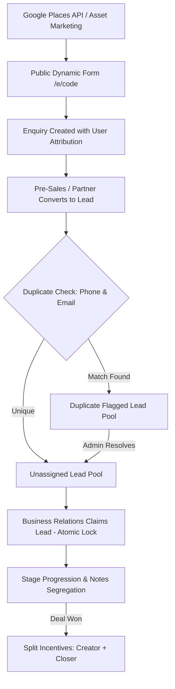

# Schoolites - Project Specification & Architecture Reference Document

## 1. Project Overview & True Scope
**Schoolites** is a specialized B2B Enterprise CRM and Multi-Actor Business Development Portal for educational software / ERP sales targeting educational institutions (Schools, Colleges, Universities, and Educational Organizations).

It is **NOT** an open educator monetization platform (that was an unrelated workspace rule from another project). 
Instead, Schoolites is a structured, production-grade B2B sales engine designed to acquire educational institutions through a coordinated pipeline of Pre-Sales outreach, Referral Partners, and Business Relations closers.

---

## 2. Actors & Role Responsibilities

### Actor 1: Root Administrator
* **User Management:** Create, deactivate, and monitor users across all 3 teams with sequential unique codes (`ADM-101`, `PS-102`, `REF-103`, `BR-104`).
* **Dynamic Form Configurator:** Toggle fields between Required, Optional, or Hidden for both Enquiry Forms and Lead Forms without code deploys.
* **Asset Hub:** Create and curate promotional assets (text, images, PDFs, video links) for marketing campaigns.
* **Incentive & Commission Governance:** Manage default payout rates (Pre-Sales 10%, Referral Partner 20%, Business Relations 10%), approve invoices, and record payouts with UTR/Transaction Reference IDs.
* **Lead Pool Oversight & Duplicate Resolution:** Central visibility into all leads, reassignment authority, and duplicate flag clearing.
* **Audit & Compliance Logs:** Full immutable audit trail recording every login, status change, claim, and administrative action.
* **Places Data Staging:** Execute Google Places API (New) searches and release curated batches to teams.

### Actor 2: Pre-Sales Team (`PS-xxx`)
* **Outreach & Unique Links:** Access marketing assets with unique shareable links (`/e/PS-xxx`) to drive organic institute enquiries.
* **Enquiry Management:** Access incoming enquiries submitted through their unique links.
* **Lead Conversion:** Qualify prospects and convert validated enquiries into official Leads in the unassigned pool.
* **Direct Lead Creation:** Enter qualified leads with full SPOC and Decision Maker information.
* **Incentive Tracking:** Track earned and pending 10% incentives upon deal closure by Business Relations.

### Actor 3: Referral Partner (`REF-xxx`)
* **Partner Hub & Unique Links:** Dedicated workspace with personal referral link (`/e/REF-xxx`).
* **Lead Submission:** Submit direct institute referrals.
* **Commission Tracking:** Track 20% commission rates on closed business.
* **Invoice Submission:** View pending/cleared commissions and submit billing invoices for Admin payment clearance.

### Actor 4: Business Relations Team (`BR-xxx`)
* **Unassigned Leads Pool:** Browse new leads created by Pre-Sales and Referral Partners.
* **Atomic Lead Claiming ("Grab"):** First-come-first-served atomic claim mechanism with HTTP 409 conflict handling to prevent double claims.
* **Deal Progression:** Manage assigned leads through stages (*New -> Contacted -> Presentation -> Proposal Sent -> Won / Lost*).
* **Dual-Tier Notes:**
  * **Private Notes:** Strictly confidential to the claiming manager (+ Admin).
  * **Public Remarks:** Global remarks visible to the lead's creator (Pre-Sales or Referral Partner).
* **Reassignment Authority:** Only the current assigned manager or an Admin can reassign a lead to another rep.

### Actor 5: Promoter Partner (`PM-xxx`)
* **Unique Promotional Link:** Dedicated marketing link (`/e/PM-xxx`) to generate institutional inbound enquiries.
* **Shared Enquiries Pool:** Enquiries generated by promoters appear in a shared pool where Pre-Sales/BR reps can claim them (enforcing a max 5-uncontacted WIP limit to prevent hoarding).
* **Live Pipeline Tracking:** Promoters track their enquiries and converted leads in real-time across both Enquiry Stages and Lead Stages (with SPOC privacy protection / masked contact details).
* **Commission Attribution:** When an enquiry sourced by a promoter is closed/won, the promoter receives their configured commission payout.

---

## 3. Data Pipeline & Lifecycle



---

## 4. Default Field Specifications

### Dynamic Enquiry Form (`/e/[code]`)
* **SPOC / Contact Info:** Name\*, Phone Number\*, Email
* **Institute Info:** Type\* (School, College, Institution, University, Other), Name of Org\*, Country\*, City, Student Count, Website, Message

### Lead Qualification Form
* **Institute Info:** Type\*, Name\*, Country\* (Searchable dropdown with auto-filter, default India, excludes Pakistan), City\*, Student Strength\* (Dropdown brackets: Below 500, 500 - 1000, 1000 - 2000, 2000 - 3000, 3000 - 4000, 4000+), Current ERP\* (Yes / No / Unsure - if yes, which one)
* **Contact Details:**
  * **SPOC\*:** Name, Role/Designation, Mobile/WhatsApp, Email
  * **Decision Maker\*:** Name, Role/Designation, Mobile/WhatsApp, Email (checkbox to copy SPOC, unchecked by default)
  * **Additional Contact:** ERP Admin / IT Head info
* **Decision Flow & Connect Slot:**
  * Preferred Slot Date, Time, Mode (Phone/WhatsApp Call [default] / Virtual Meet / Unsure)
  * **Expected Start Date:** Hybrid timeline selector (Immediately [1-2 weeks], Within 1 Month, Within 2-3 Months, Next Academic Session, Flexible / Exploring, or Specific Date picker)
  * Decision Flow: Multiline text input
  * Additional Notes: Multiline text input

---

## 5. Security & Business Logic Rules

1. **Dual Credit on Won Deals:** When a deal closes successfully, both the **Owner** (Pre-Sales, Referral, or BR creator) and the **Manager** (Business Relations closer) receive their respective incentive percentages.
2. **Canonical Terminology Standard:**
   * **Lead Owner:** The individual who originated/created the lead (`owner_id`). Can belong to any team: Business Relations (`BR-xxx`), Referral Partner (`REF-xxx`), or Pre-Sales (`PS-xxx`).
   * **Lead Manager:** The dedicated representative actively working on, handling, and closing the lead (`manager_id`). Always belongs to the Business Relations team (`BR-xxx`).
3. **Atomic Grab:** Concurrent claims on the same lead use database-level transactional locks (`WHERE assigned_manager_id IS NULL`) to ensure only one user wins.
4. **Duplicate Detection:** Automatic matching on SPOC Phone Number and Email. Flagged leads remain visible to all parties, but prompt an Admin review action to prevent commission disputes.
5. **Action Confirmation Modals:** Every sensitive action (deactivating a user, claiming a lead, reassigning, resolving duplicates) requires explicit user confirmation.
6. **Session & Auth:** Custom secure JWT session cookies with 6-digit email OTPs. Dev mode provides local OTP auto-fill for testing.

---

## 6. Implementation Status

| Phase | Description | Status |
| :--- | :--- | :--- |
| **Phase 1** | Neon PostgreSQL schema, connection pooling, custom OTP auth | ✅ Complete |
| **Phase 2** | Root Admin portal: User management, dynamic form configurator, audit logs, database inspector | ✅ Complete |
| **Phase 3** | Marketing Asset Hub, public enquiry pages (`/e/[code]`), Pre-Sales & Referral Partner workspaces | ✅ Complete |
| **Phase 4** | Business Relations workspace, atomic lead claiming, note segregation, duplicate detection engine | ✅ Complete |
| **Asset Storage Upgrade** | Neon Object Storage (`storage-bucket`): 5MB image/PDF uploads, subfolder structure (`assets/${assetId}/`), video links, asset editing, and automated bucket folder cleanup | ✅ Complete |
| **Partner Workspace Alignment** | Synchronized Pre-Sales and Referral Partner asset views with Admin (inline carousels, lightbox zoom, monospace body text copy, single/all download prompts) | ✅ Complete |
| **Card Layout Polish** | 2-line instruction clamp with inline toggle (`Show full instructions ▼ / Show less ▲`) + auto-adjustable body pitch text box (`flex: 1` consuming empty voids on text cards) | ✅ Complete |
| **Interactive Asset Image Manager** | Edit modal shows active thumbnails with individual `✕` removal, remaining slot counter, and targeted Neon S3 deletion of removed objects | ✅ Complete |
| **Lead Form Enhancements** | Searchable country select (defaults India, strictly excludes Pakistan), student strength bracket dropdown (`Below 500` to `4000+`), hybrid expected start date selector, optional expandable additional contact details (Name, Role, Mobile, Email), and clean un-prefilled designations with descriptive placeholders | ✅ Complete |
| **ActorShell Architecture** | Unified sticky header and expandable/collapsible sidebar (260px expanded / 72px icon rail with toggle) tailored per actor (Admin, Pre-Sales, Referral, Business Relations) with instant tab-switching, My Account profile dropdown menu, and persistent state | ✅ Complete |
| **Brand Identity & Favicon** | Integrated official Schoolites circular logo (geometric origami motif + cursive script) across favicon (`/favicon.ico`, `/icon.png`), sidebar brand header (`Schoolites ERP`), login portal, root redirect, and public enquiry page | ✅ Complete |
| **Mobile Responsiveness Engine** | Universal off-canvas slide drawer (`<= 768px`) with dark backdrop overlay, auto-closing nav links, sticky header with ellipsis protection, fluid workspace containers (`.workspace-container`), responsive horizontal scrolling on all data tables (`.table-responsive`), responsive modal dialogs (`.modal-backdrop` & `.modal-dialog`), and responsive OTP inputs | ✅ Complete |
| **Lead Terminology Alignment** | Enforced platform-wide canonical terminology: `Lead Owner` (creator across any team) and `Lead Manager` (assigned representative in Business Relations) across tables, modals, cards, and reassign flows | ✅ Complete |
| **Lead View Completeness & UI Simplification** | 100% field parity between Create & View forms (rendered missing `additional_details` notes & converted source enquiry badge), removed unneeded `deal_value` from pipeline tables and modals, and standardized `STAGE STATUS` & `Action` column headers across all actors | ✅ Complete |
| **Audit Timeline Enhancements** | Reverse chronological ordering (`ORDER BY created_at DESC`), two-line Date (`DD MMM YYYY`) and Time (`hh:mm a`) timestamp display, and human-readable event descriptions (stage changes, claims, creator registration) | ✅ Complete |
| **Pipeline Connect Slot Alignment** | Replaced `SPOC Contact` with `Preferred Connect Slot` on leads pipeline tables across Admin, Business Relations, Pre-Sales, and Referral Partners (with clean date/time and mode formatting) | ✅ Complete |
| **Native Connect Time Input Format** | Converted `preferred_slot_time` from arbitrary text to native `<input type="time">` (dark theme styled) with `form_field_configs` schema updated to `time`, and automatic 12-hour AM/PM formatting across all views | ✅ Complete |
| **Full-Width Workspace Canvas** | Removed `max-width: 1400px` centering clamp from `.workspace-container`, allowing dashboards and data tables to expand across the full screen width seamlessly | ✅ Complete |
| **Version Control Sync** | Connected to GitHub (`https://github.com/rizwanrko77/schoolites-crm.git`) on `main` branch with strictly ignored `.env.local` | ✅ Complete |
| **Phase 5** | Google Places API (New) integration, CSV import, staging deduplication, and batch allocation | ✅ Complete |
| **Phase 6** | Contract invoices, snapshotted commission splits, and UTR payout clearance. Only an administrator can mark an invoice cleared. | ✅ Complete |

---

## 7. Mobile Responsiveness Architecture

### Viewport & Containers:
* **Viewport Config:** Explicitly exported in [`src/app/layout.tsx`](src/app/layout.tsx) with `width: device-width, initialScale: 1, maximumScale: 5`.
* **Universal Workspace Container (`.workspace-container`):** Replaced hardcoded paddings (`32px 40px` / `28px 36px`) across Admin, Pre-Sales, Referral, and Business Relations with responsive padding:
  * Desktop (`> 768px`): `padding: 28px 36px; width: 100%;` (full width responsive canvas)
  * Tablet/Mobile (`<= 768px`): `padding: 16px 12px; gap: 16px;`
  * Small Phone (`<= 480px`): `padding: 12px 8px; gap: 14px;`

### Navigation & Header Mechanics:
* **Off-Canvas Slide Drawer (`ActorShell.tsx`):**
  * Breakpoint: `<= 768px`.
  * Width: `270px` with smooth cubic-bezier slide (`transform: translateX(0)` vs `translateX(-100%)`).
  * Backdrop: Fixed full-screen backdrop with `rgba(5, 8, 16, 0.82)` and `backdrop-filter: blur(12px)`.
  * Auto-Close: Automatically closes drawer on backdrop tap, `✕` button tap, or any nav item / link selection.
  * Content Margin: Main workspace has `marginLeft: 0px` on mobile, reclaiming 100% of the screen width.
* **Sticky Header:**
  * Height: `58px` on mobile, `64px` on desktop.
  * Section title protected with `text-overflow: ellipsis` and `maxWidth` constraint so it never crowds out action buttons.
  * Profile Menu: "My Account" collapses to circular user initial badge + chevron on mobile, saving horizontal space while preserving full user info popover.

### Table & Modal Adaptations:
* **Horizontally Scrollable Tables (`.table-responsive`):**
  * Applied across all actor lead tables, enquiry tables, users tables, and audit log tables.
  * Ensures table width maintains `min-width: 680px` for clear legibility without squishing data into vertical single-character columns.
* **Responsive Modals (`.modal-backdrop` & `.modal-dialog`):**
  * `CreateLeadModal.tsx` & `LeadDetailModal.tsx`:
    * Backdrop padding reduced to `10px 8px` on mobile.
    * Modal dialog padding reduced to `20px 14px` on mobile with `maxHeight: 94vh`.
    * Form grids utilize `.col-span-2-responsive` (collapses to 1 column on mobile phones `<= 640px`).
    * Navigation tabs in `LeadDetailModal` scroll smoothly on mobile with `overflowX: auto` and `whiteSpace: nowrap`.
* **Auth & Public Enquiry Cards:**
  * `.auth-card` and `.enquiry-card` padding adapts to `28px 18px` on mobile screens.
  * 6-digit OTP verification inputs dynamically flex (`minWidth: 36px`, `maxWidth: 52px`, `gap: 6px`) to fit even 320px devices without clipping.
* **Lead Modal Contact Layout (`.contact-grid-2col`):**
  * SPOC, Decision Maker, and Additional Contact sections use a symmetrical 2x2 grid on desktop/laptop:
    * Row 1: Contact Name | Designation / Role
    * Row 2: Mobile / WhatsApp | Email Address
  * Mobile view (< 640px) seamlessly collapses into a clean 1-column stack (1 field per row).
  * Designations are completely un-prefilled (`''`) with descriptive placeholders and `autoComplete="off"`.
  * **Zero Pre-filled Fields Policy (Country Preserved as India):**
    * All select dropdowns (`institute_type`, `student_strength`, `current_erp`, `preferred_slot_mode`, `expected_start_date`) default to empty unselected prompt options (`-- Select ... --`).
    * `preferred_slot_time` defaults to empty (`''`) with a placeholder prompt (`e.g. 11:30 AM or 3:00 PM`).
    * `Country` retains its preset default to `India` per user requirement with searchable dropdown support.
  * **Lead Form Draft Persistence (`localStorage`):**
    * In-progress lead details auto-save to browser `localStorage` (`schoolites_lead_form_draft`).
    * If a user closes the modal accidentally or refreshes the page, reopening the modal automatically restores all entered details, presets, and additional contacts.
    * Automatically purges draft upon successful lead submission.
    * Inbound enquiry conversions prioritize enquiry attributes over manual drafts.
  * **Two-Stage Clear Form Action:**
    * Modal header features a `Clear Form` button (`id="clear-lead-form-btn"`) beside the close (`✕`) button.
    * Implements a safe, non-blocking 2-stage inline confirmation (`Clear Form` -> `⚠️ Confirm Clear?`) that auto-reverts after 4 seconds to prevent accidental data loss.
    * Completely purges the local draft and resets all fields back to blank defaults (`Country: India`).
  * Admin Form Configurator (`/admin/forms` & `form_field_configs` table) synchronized with all 25 lead fields including `additional_contact_*` and `expected_start_date`.
  * **Business Relations Portal Sectioned Architecture (`/business`):**
    * **ActorShell Section Headers:** Extended `NavItem` with optional `section?: string`. Expanded sidebar displays clean uppercase section headers (`GLOBAL PIPELINE` & `MY DIRECT SOURCING`), while collapsed icon rail renders subtle horizontal dividers.
    * **Section 1: Global Pipeline:**
      * `⚡ Unassigned Pool`: Unclaimed company leads available for atomic grab.
      * `🎯 Assigned to Me`: Active opportunities where user is assigned manager/closer.
      * `🌐 All Leads Directory`: Company-wide lead directory for cross-team visibility.
    * **Section 2: My Direct Sourcing & Inbound:**
      * `📝 My Generated Leads`: Leads directly originated by the BR rep (`owner_id === user.id`) with closing stage & incentive attribution.
      * `📥 Inbound Enquiries`: Captures inbound enquiries from rep's unique public referral link (`/e/[user_code]`), with status tracker (`new`, `contacted`, `qualified`, `disqualified`) and 1-click **Convert to Lead** workflow.
      * `📁 Marketing Assets`: Full collateral hub with category filter pills, WhatsApp pitch copy, multi-image carousels, lightbox zoom, and brochure downloads.

---

## 8. Marketing Assets Architecture (Reference for Resuming)

### File Structure & Storage Paths:
* **Neon S3 Bucket:** `storage-bucket` (Singapore `ap-southeast-1`, custom endpoint).
* **Asset Subfolder Convention:** `assets/${assetId}/${timestamp}-${cleanName}`.
* **Database Representation:**
  * `assets.storage_key`: Points to primary/first file.
  * `assets.files`: JSONB array of all uploaded files with `{ url, storage_key, name, size, mime_type }`.
  * `assets.body_text`: Outreach message / WhatsApp copy.
  * `assets.description`: Internal rep usage instructions.

### Deletion & Edit Cleanups:
* Complete asset deletion purges the entire subfolder `assets/${assetId}/` using `deleteAssetFolderFromStorage(assetId)`.
* Partial image deletion during edit targets only the removed storage keys via `deleteFromStorage(removedKey)`.

### Card UI Mechanics:
* **Instructions Clamp:** 2-line WebKit box clamp with inline `Show full instructions ▼ / Show less ▲` toggle to prevent vertical blowout across grid rows.
* **Auto-Adjustable Pitch Text:** Text-only assets automatically expand (`flex: 1`, min 180px, max 300px) to utilize grid row height, eliminating empty black voids.

---

## 9. Shipped follow-ups

The old resume notes in this section listed a fixed OTP of `123456` and three unfinished items. Those are done:

* The 11-stage lead pipeline, including demo, follow-up, and onboarding statuses, is in `src/lib/leadStatuses.ts` and the database check constraint.
* Places search, CSV import, and batch allocation are live.
* Invoice clearance and UTR payout recording are live. Only an administrator can mark an invoice cleared.

There is no fixed bypass code. Production login emails a one-time code. Setup is in [docs/DEPLOYMENT.md](docs/DEPLOYMENT.md).

The lead form still starts blank except Country (`India`), still drafts to `localStorage`, and the Business Relations sidebar is still split into Global Pipeline and My Direct Sourcing.

---

## 10. Lead Management, Stage Governance & Handover Architecture

### Role-Based Stage Status Permissions:
* **Status Editing Control:**
  * **Pre-Sales Representatives & Referral Partners:** Status indicator is strictly rendered as an immutable pill/badge (`● {status}`). They cannot change pipeline stages or progress leads.
  * **Assigned Lead Manager & Admin:** Status select dropdown is active only for the assigned Lead Manager (`lead.manager_id === user.id`) and system Admins.
  * **Closed Deals Lock:** Deals in `won` or `lost` states are fully locked from status modification or editing by sales reps. Only Admins can edit or reopen finalized deals to protect commission settlements.

### Lead Details Editing & Audit Trail:
* **Eligibility:** Lead Owner (creator), assigned Lead Manager, and Admins can click `✏️ Edit Details` in the Lead Detail modal.
* **Editable Attributes:** Institution name, institution type, country, city, student strength, current ERP status, existing ERP name, expected start timeline, SPOC contacts, Decision Maker contacts, Additional contact details, and preferred connect slot.
* **Duplicate Safeguards:** Validates SPOC phone and email against existing records upon saving to prevent collisions.
* **Granular Field-Level Diffs:** Backend compares submitted values against current database state and immutably records a `lead_updated` entry in `audit_logs` containing exact `{ from, to }` transitions for each changed attribute.
* **Timeline UI:** Tab 4 (Audit Timeline) renders field transition chips (`[field]: [old_val] ➔ [new_val]`) with relative timestamp and actor attribution.

### Business Relations Reassignment & Personal Notes Handover:
* **Reassignment Permissions:** Only current assigned Lead Manager and Admins have access to the `Reassign ⇄` workflow.
* **Target Validation:** Targets are restricted strictly to active `business_relations` representatives via `/api/leads/managers`. Reassignment to the current manager or non-BR actors is blocked both on frontend and backend.
* **Personal Notes Handover Architecture:**
  * When a lead is reassigned, previous managers' internal notes are preserved with original author attribution.
  * The newly assigned Lead Manager automatically receives read access to personal notes left by previous BR managers on that lead.
  * In Tab 2 (Personal Notes), handover notes are distinguished with an amber border and prominent badge: `📋 Handover Note from Previous Manager: [Name] ([Code]) • [Timestamp]`.
  * **Partner Privacy Isolation:** External Referral Partners and Pre-Sales junior reps continue to only have visibility into `visibility = 'global'` remarks. Private handover notes are completely isolated from external partners.

### Pipeline Table & UI Enhancements:
* **Full-Width Portal Layout:** Expanded leads tables and views across all roles to utilize full screen width (`w-full max-w-full px-4 sm:px-6 lg:px-8`), eliminating cramped containers and wasted sidebar margins.
* **Preferred Connect Slot Display:** Replaced redundant SPOC column on pipeline tables with `Preferred Connect Slot` (Date, Time & Discussion Focus) for immediate scheduling visibility across all actors.

---

## 11. Pipeline Table Search, Filter, Sort & Stage Confirmation Architecture

### Comprehensive Multi-Field Search:
* **All Form Attributes Included:**
  * Search query in `/api/leads` now inspects 100% of the attributes captured in the lead creation form:
    * Lead code, institution name, institution type, city, country, student strength.
    * Current ERP status, existing ERP brand name.
    * SPOC name, SPOC role, SPOC phone, SPOC email.
    * Decision Maker name, DM role, DM phone, DM email.
    * Additional contact name, role, phone, and email.
    * Decision flow notes, preferred slot date/time/mode, expected start timeline, additional details.
    * Originating Lead Owner code/name and assigned Lead Manager code/name.
  * Instant real-time feedback with inline clear (`✕`) button.

### Multi-Select Status Filter & Sorting Controls:
* **Reusable `LeadTableControls` Component:** Unified across `/admin/leads`, `/business`, and `PartnerWorkspace` (`/referral` & `/presales`).
* **Multi-Select Stage Popover:**
  * Displays checklist of all statuses with corresponding colored indicator dots.
  * Includes quick-action links: `All` (select all) and `Clear` (unselect all).
  * Dynamic button badge reflects current selection: `All Stages` or `Stage (N)`.
* **Flexible Sort Dropdown:**
  * 🕒 Created Time: Newest First (`created_desc` - default)
  * 🕒 Created Time: Oldest First (`created_asc`)
  * 🔄 Last Updated: Most Recent First (`updated_desc`)
  * 🔄 Last Updated: Oldest First (`updated_asc`)
* **Clickable Table Column Headers:**
  * Interactive headers on `Lead Code & Owner`, `Institution & City`, `Preferred Connect Slot`, `Stage Status`, and `Lead Manager`.
  * Visual sort direction indicators (`▲` / `▼` / `↕`) with immediate in-memory reordering.
* **Filter State Persistence & One-Click Reset:**
  * State persists in browser `sessionStorage` per portal view, preventing loss of filters when opening lead detail modals or refreshing.
  * Prominent `✕ Clear Filters` button appears whenever search, non-default status filters, or custom sorts are active, restoring default views in one click.

### Accidental Click Prevention: Stage Transition Confirmation Alert:
* **Safe Transition Modal:**
  * Changing the status dropdown in `LeadDetailModal` no longer immediately mutates the record.
  * Prompts the user with a confirmation alert dialog:
    * Old Stage ➔ New Stage visual transition chips styled with status badge colors.
    * Closed Deal Governance Caution: Prominently warns when transitioning to `Won 🏆` or `Lost`: *"Marking a deal as Won or Lost finalizes the deal and locks stage/details modification for regular representatives. Only an Administrator can reopen or edit closed deals."*
    * `Cancel` cleanly reverts the select element without API calls.
    * `✓ Confirm Stage Change` triggers the PATCH update and refreshes timeline audit logs.

### Centralized Status Architecture (`src/lib/leadStatuses.ts`):
* Single source of truth defining status keys, human-readable labels, theme colors, background colors, border styles, and closed-deal flags.
* Architecture designed for future status pipeline expansions with zero UI code duplication.

---

## 12. Full Pipeline Lifecycle (11 Stages), Shallow URL Sync & Resilient Auto-Sync

### Expanded 11 Pipeline Lifecycle Stages:
* **Database Constraint Migration:**
  * Updated `leads_status_check` check constraint in Neon PostgreSQL via `src/scripts/migrate-lead-statuses.ts`.
  * The database and UI now support the complete 11-stage sales lifecycle:
    1. `unassigned` — Unassigned Pool ⚡
    2. `assigned` — Assigned 🎯
    3. `demo_scheduled` — Demo Scheduled 📅
    4. `demo_completed` — Demo Completed ✅
    5. `in_discussion` — In Discussion 💬
    6. `following_up` — Following Up 🔄
    7. `proposal_sent` — Proposal Sent 📄
    8. `onboarding_initiated` — Onboarding Initiated 🚀
    9. `onboarding_completed` — Onboarding Completed 🎓
    10. `won` — Won 🏆 *(Closed Deal Governance: locks deal from rep modifications)*
    11. `lost` — Lost ❌ *(Closed Deal Governance: locks deal from rep modifications)*
* **Visual Styling & Badges:**
  * Configured in `src/lib/leadStatuses.ts` with dedicated theme colors, background tints, border colors, and metadata descriptions.

### Shallow URL Tab Sync (`?tab=...`):
* **Zero-Reload State Syncing:**
  * Implemented across `/business`, `PartnerWorkspace` (`/referral` & `/presales`), and `/admin/leads`.
  * URL query parameter reflects the current view (e.g. `/business?tab=my`, `/business?tab=unassigned`, `/referral?tab=enquiries`).
  * Uses `window.history.replaceState` for instantaneous 0ms client-side switching without triggering SSR reloads.
  * Preserves the active tab across page refreshes, direct link sharing, and bookmarks.

### Resilient, Zero-Compute Pipeline Auto-Sync (`usePipelineAutoSync`):
* **Architectural Rationale:**
  * Evaluated Neon Realtime (WebSockets) vs. Smart Visibility Syncing. Because continuous WebSockets consume dedicated capacity hours ($0.10/hr) and keep database instances from sleeping, we chose a zero-dependency, zero-cost architecture.
* **Three-Layer Synchronization Engine:**
  1. **Window-Focus Sync:** Automatically executes a quick, stateless fetch the second the user clicks back onto the CRM tab.
  2. **Visibility-Change Sync:** Listens to `document.visibilitychange` to immediately catch up when un-minimizing or switching browser tabs.
  3. **In-View Polling:** Gently refreshes every 30 seconds only while the tab is actively visible.
* **Cost & Battery Benefits:**
  * **$0 Extra Cost:** Uses standard stateless HTTP serverless endpoints (`sql = neon(...)`).
  * **100% Preserves Neon "Scale-to-Zero":** When staff close or leave tabs idle for 5 minutes, Neon automatically scales compute to zero ($0 cost).
  * **Zero External Dependencies:** Built with native browser APIs.

---

## 13. Lead Manager & Stage Lifecycle Synchronization

### Problem Addressed:
1. **Orphaned Assigned Leads:** Previously, when a lead was in the unassigned pool (`manager_id = NULL`) and an Admin changed status to `assigned` (or any active stage), only the status changed while `manager_id` remained `NULL`. The Admin then had to open the Reassign dialog in a separate step.
2. **Ghost Manager on Unassignment:** Conversely, when an assigned lead was moved back to `unassigned`, only the status field updated while the previous `manager_id` remained in the database, leading to contradictory records (unassigned status with an active manager).

### Implemented Architectural Solution:
1. **Atomic Lead Manager Assignment on Pool Exit:**
   * When moving a lead out of the Unassigned pool (`status === 'unassigned'` or `manager_id === NULL`) into any active stage (`assigned`, `demo_scheduled`, `in_discussion`, etc.):
     * The stage transition confirmation dialog detects the unassigned state and requires selecting a **Lead Manager** from active Business Relations team members.
     * If the logged-in user is a Business Relations representative, it automatically defaults to their user account. If Admin, it prompts selection via a dropdown.
     * The "Confirm Stage Change" button is disabled until a representative is chosen.
     * The API (`PATCH /api/leads/[id]`) atomically updates both `status` and `manager_id` in a single query.
2. **Automatic Manager Cleanup on Unassignment:**
   * When any lead is moved back to `unassigned`:
     * The confirmation dialog warns the user: *"Changing stage status to Unassigned will automatically remove [Manager Name] and return this lead to the general unassigned pool."*
     * In `PATCH /api/leads/[id]`, setting `status === 'unassigned'` automatically forces `manager_id = NULL`.
3. **Comprehensive Audit Trail:**
   * Granular audit logs recorded in `audit_logs`:
     * `lead_assigned`: When an unassigned lead is assigned to a representative for the first time.
     * `lead_reassigned`: When an assigned lead is transferred between representatives.
     * `lead_unassigned`: When an assigned lead is returned to the unassigned pool, tracking the former manager.
     * `lead_status_changed`: Tracking the exact `from` and `to` lifecycle stages.
4. **Private Notes Forwarding & Preservation:**
   * Personal notes are never deleted or modified when a lead moves into the unassigned pool.
   * Upon reassignment or claim by a new Lead Manager, all historical personal notes written by any prior Business Relations representative on that lead are automatically forwarded and readable by the newly assigned manager.
   * Referral and Pre-Sales partners remain strictly restricted from viewing internal Business Relations notes.
5. **Clean UI & Badge Layout:**
   * Removed legacy bullet dots (`●`) from all lead status pills and `<select>` dropdown options across tables and modals.
   * Enforced `display: 'inline-flex'` and `whiteSpace: 'nowrap'` on all status badges to ensure single-line rendering without vertical wrapping.

---

## 14. Promoter (Affiliate) Actor Architecture & 3-Tier Attribution Model

### Actor Overview & Role Definition:
* **Actor Role:** `'promoter'` (Affiliate Marketer / Traffic Generator).
* **User Code Prefix:** `PM-XXX` (e.g. `PM-109`).
* **Role Badge & Theme:**
  * CSS Variable: `--role-promoter-color: #f43f5e`, `--role-promoter-bg: rgba(244, 63, 94, 0.12)`, `--role-promoter-border: rgba(244, 63, 94, 0.3)`.
  * Class: `.badge-role.promoter`.
* **Primary Function:** Promoters share unique public landing links (`/e/PM-XXX`) across WhatsApp, social media, and academic networks to drive inbound institutional enquiries. Promoters do **not** validate enquiries or create leads directly.

---

### 3-Tier Attribution Architecture:
When an enquiry originates from a promoter's unique link and converts into a paying school client, the system tracks complete 3-tier attribution:
1. **`promoter_id` (`PM-XXX`):** The affiliate partner who generated the inbound traffic and captured the initial enquiry.
2. **`owner_id` (`PS-XXX` or `BR-XXX`):** The in-house Pre-Sales (or Business Relations) representative who qualified the enquiry and officially originated the active lead.
3. **`manager_id` (`BR-XXX`):** The assigned Business Relations manager responsible for conducting product demonstrations, commercial negotiations, and closing the deal.

---

### Database Schema Updates (Neon PostgreSQL):
1. **Role Check Constraint:**
   * Updated `users_role_check`: `role IN ('admin', 'pre_sales', 'referral', 'business_relations', 'promoter')`.
2. **Configurable Commission Rate:**
   * Added `commission_rate NUMERIC(5, 2) DEFAULT 10.00` to the `users` table.
   * Admins can configure individual commission percentages per user (defaults to 10.00%).
3. **Attribution Foreign Keys:**
   * Added `promoter_id UUID REFERENCES users(id) ON DELETE SET NULL` to `enquiries` (with index `idx_enquiries_promoter_id`).
   * Added `promoter_id UUID REFERENCES users(id) ON DELETE SET NULL` to `leads` (with index `idx_leads_promoter_id`).

---

### Inbound Enquiry Handling & The "Promoter Enquiries Pool":
1. **Enquiry Capture (`POST /api/enquiries`):**
   * When a visitor submits a form on `/e/PM-XXX`, the system recognizes `owner.role === 'promoter'` and sets `promoter_id = owner.id`.
2. **Dedicated Promoter Pool Tab for Pre-Sales & Business Relations:**
   * Inbound enquiries with `promoter_id IS NOT NULL` enter a shared **"Promoter Enquiries Pool"**.
   * Accessible as a sub-tab inside the Inbound Enquiries view in `/presales` (`PartnerWorkspace.tsx`) and `/business` (`src/app/business/page.tsx`).
   * Representatives see the originating Promoter badge (`PM-109 XYZ Sharma`), full SPOC contacts (phone, email), and school info to perform qualification calls.
   * Clicking **"Convert to Lead ➔"** opens `CreateLeadModal` with `source_enquiry_id`.
3. **Inherited Attribution on Lead Creation (`POST /api/leads`):**
   * When converting a promoter enquiry, `POST /api/leads` automatically resolves and inherits `promoter_id` from the source enquiry.
   * The converting representative becomes `owner_id`, and `promoter_id` is permanently locked onto the active lead.

---

### Data Privacy & Disintermediation Prevention:
* **Contact Masking:** Promoters are external traffic generators. To protect institutional client data and prevent disintermediation:
  * For promoters querying `/api/enquiries`, SPOC phone is masked (e.g. `987*****21`) and email is obfuscated.
  * For promoters querying `/api/leads`, decision-maker (DM) and additional contact details are completely nullified, and SPOC phone/email are masked.
  * Direct requests to `/api/leads/[id]` from promoters are rejected with `403 Forbidden`.
* **High-Level Pipeline Status Only:**
  * Promoters only see high-level pipeline tables (School Name, City, Lifecycle Stage, Deal Value, Calculated Commission, Date).
  * No access to internal sales notes, call remarks, or deep CRM drawers.

---

### Dedicated Promoter Portal (`/promoter`):
1. **Authentication & Routing:**
   * Protected route backed by `ActorShell` with promoter identity styling (`--role-promoter-color: #f43f5e`).
   * Login automatically redirects `role === 'promoter'` to `/promoter`.
2. **Consistent Actor Layout:**
   * Uses `.workspace-container` matching `PartnerWorkspace` (`/presales` and `/referral`).
   * **Public Referral Link Banner:**
     * Features dynamic URL (`/e/PM-XXX`), `borderLeft: 4px solid var(--role-promoter-color)`, 1-click **📋 Copy Link**, and **Preview Page ↗** (external WhatsApp share button removed per user request).
     * Rendered cleanly at the top of the Inbound Enquiries and Marketing Assets tabs.
   * **Header Actions:** Removed redundant header copy button to maintain a clean top bar consistent with other partner actors.
3. **Decoupled Revenue & Commission Splitting:**
   * In-line commission/split cards have been removed from the primary promoter dashboard to maintain clean pipeline visibility consistent with other actor portals.
   * Revenue sharing, commission tiers, and split calculations will be centrally managed in a dedicated business & payouts page.
4. **Three Primary Workspaces:**
   * **Marketing Assets Hub:** Exactly mirrors `PartnerWorkspace` (`/referral?tab=assets`):
     * Structured card layout with dual badges: uppercase file type with icon (`🖼️ IMAGE`, `📄 PDF`, `🎥 VIDEO LINK`, `📝 TEXT`) and category pill.
     * Direct inline previews with multi-file carousel scrollers (`‹`, `›`), zoom button (`🔍 Zoom`), and slide indicators (`• • 1/2`).
     * Type-safe rendering (prevents broken `` tags on video link and text assets).
     * Truncated usage instructions with collapsible `Show full instructions ▼` / `Show less ▲` toggles.
     * Monospace pre-formatted pitch script box with sticky `📋 Copy Text` button.
     * Contextual card actions: `📥 Download (N)` / `📥 Download` + `👁️ View` for images, `📥 Download PDF` + `👁️ Open ↗` for PDFs, `🔗 Copy Link` + `▶ Watch ↗` for video links, and `📋 Copy Pitch Script` for pitch templates.
     * Full interactive modals: `downloadPromptAsset` dialog (choose current image vs. all images) and full-screen `lightboxData` modal with multi-file navigation.
   * **Inbound Enquiries:** Clean table tracking incoming enquiries with masked contact details, city, student count, and Pre-Sales qualification handling stage.
   * **My Generated Leads:** Uses standard `LeadTableControls` (search, multi-status filter modal, column sorting, and clear filters) with clean stage badges (Demo Scheduled, In Discussion, Won, Lost), connect slots, and assigned Lead Manager.
5. **Zero-Compute Auto-Sync:**
   * Connected to `usePipelineAutoSync` for seamless background updates on window focus without database polling overhead.

---

## 15. Client Contracts, Invoices, and Revenue Collection Governance

### 1. Revenue Governance Principle: Cleared Cash vs. Potential Business
* **Potential Business / Backlog:** Total agreed Contract Value and pending/raised invoices. Represents future pipeline receivables and partner earnings projections.
* **Cleared Revenue (Eligible for Splits & Payouts):** Strictly calculated on invoices with status `cleared` (cash verified and received in the bank account). Commissions and actor payouts are never disbursed on uncollected receivables.

### 2. Client Lifecycle & Contract Module (`LeadDetailModal`):
* **Dynamic Tab Activation:** The `📄 Contract & Invoices` tab unlocks in `LeadDetailModal` when `status === 'won'` or when a signed contract is attached.
* **Role Access Protection:**
  * **Admin & Business Relations (BR Closers):** Full access to create, edit, and track client contracts and issue milestone invoices.
  * **Pre-Sales, Referral Partners, Promoters:** Hidden. External partners never see internal school billing line items, invoice terms, or bank references (UTRs). Instead, partners track their client portfolio, potential incentives, and cleared earnings through their dedicated Business / Payouts workspace.
* **Database Tables:**
  * **`lead_contracts`:** 1-to-1 with Won Leads (`contract_amount`, `duration_months`, `start_date`, `end_date`, `status`, `notes`, `created_by`).
    * Client Contract Status: `active` (default), `completed`, `terminated`, `renewed`.
    * Syncs automatically with `leads.deal_value = contract_amount`.
  * **`contract_invoices`:** Milestone installment schedule (`invoice_number`, `amount`, `due_date`, `status`, `cleared_at`, `payment_method`, `payment_reference`, `notes`).
    * Invoice Status: `raised` ➔ `pending` ➔ `cleared` (with payment reference / UTR).
* **Metrics & Ledger Ribbon:**
  * **Agreed Contract Value:** Total signed agreement value.
  * **Total Invoiced:** Sum of all issued invoices.
  * **Cash Collected (Cleared):** Sum of cleared cash payments verified in bank.
  * **Balance Pending:** Remaining receivable balance (`contract_amount - total_cleared`).

---

## 16. Canonical Role Terminology & Vocabulary Governance

To prevent confusion across actors, tables, filters, and API endpoints, the platform strictly adheres to the following role and terminology standard:

1. **Role Standard**:
   * **`Promoter` (`PM-xxx`)**: Affiliate / external traffic generator. Generates inbound enquiries via `/e/PM-xxx`. Does not qualify leads or close deals.
   * **`Owner` (`PS-xxx`, `REF-xxx`, `BR-xxx`)**: The lead creator who created/originated the lead record (Pre-Sales rep, Referral Partner, or self-sourced BR rep).
   * **`Manager` (`BR-xxx`)**: The assigned Business Relations representative actively managing the account, conducting presentations, and closing the deal.

2. **UI Wording Standards**:
   * `Closer` ➔ Standardized to `Lead Manager` or `Manager`.
   * `Lead Pipeline Stage` ➔ Standardized to `Lead Stage`.
   * `Convert to pipeline lead` ➔ Standardized to `Convert to lead` (with mandatory confirmation modal alert before action).
   * `Institutional enquiries assigned to your queue (direct inbound + claimed promoter leads)` ➔ Simplified to `Your enquiries`.
   * **Pipeline Sorting Parity**: Enquiry tables implement identical column header sorting (`▲`/`▼`) and multi-criteria sort dropdowns matching Lead tables.

---

## 17. Form Parity & Modal Unification Architecture (Create vs. Edit)

### Problem Addressed:
Previously, the Lead Creation form (`CreateLeadModal.tsx`) and the Lead Edit form (nested inline in `LeadDetailModal.tsx`) had diverged:
* `CreateLeadModal` had the refined 3-section layout, searchable country selector (with Pakistan exclusion), student strength brackets, current ERP selector, hybrid expected start date chips, and additional contact section.
* `LeadDetailModal` maintained an older inline edit form (~350 lines of duplicate JSX) that was inconsistent in styling, fields, and behavior.

### Implemented Architectural Solution:
1. **Single Source of Truth (`CreateLeadModal.tsx`)**:
   * Added `leadToEdit?: any | null` prop to `CreateLeadModalProps`.
   * When `leadToEdit` is provided, the modal automatically initializes in **Edit Mode**:
     * Pre-populates all 25 institutional and contact fields, including parsing hybrid start dates, ERP options, and additional contacts.
     * Dynamic title: `✏️ Edit Lead Details: {lead_code}` (vs. `Create New Lead`).
     * Dynamic submit button: `Save Changes ✓` (vs. `Submit Lead to Pipeline`).
     * Endpoint routing: Submitting in edit mode executes `PATCH /api/leads/${leadToEdit.id}` instead of `POST /api/leads`.
     * `localStorage` draft saving is cleanly suppressed during edit mode to prevent overwriting new-lead drafts.
     * Modal layering: Elevates `zIndex: 1300` when editing so it stacks cleanly above `LeadDetailModal` (`zIndex: 1100`).
2. **Refactoring of `LeadDetailModal.tsx`**:
   * Completely removed ~350 lines of duplicate inline edit JSX.
   * Clicking `✏️ Edit Details` now renders `<CreateLeadModal isOpen={isEditing} leadToEdit={lead} ... />`.
   * Ensures 100% field, validation, and design parity across creation and editing workflows.

---

## 18. Next.js 16 (Turbopack) SSR & Hydration Protection

1. **Non-Deterministic Prerender Protection**:
   * Next.js 16 Turbopack enforces strict prerender checks. Initializing `useState` with non-deterministic dynamic values (e.g., `new Date().toISOString()`) triggers SSR build/prerender exceptions.
   * Fixed by using deterministic, static initial values (`''`) and populating dynamic timestamps inside user-triggered event handlers or effects.

2. **Hydration Mismatch Prevention on Tab / Window State**:
   * Relying on `typeof window !== 'undefined'` or reading URL params inside `useState(() => ...)` causes the server to render a default branch while the client hydrates with the query param branch, triggering hydration errors.
   * Fixed platform-wide across `/business`, `/promoter`, `/admin/leads`, and `PartnerWorkspace`:
     * State is initialized to a stable default on both SSR and client.
     * Query param sync (`?tab=...`), `sessionStorage` restoration, and viewport measurements are executed exclusively inside post-mount `useEffect(() => { ... }, [])`.

---

## 19. Business Module & Commission Splits Architecture

### 19.1 System Overview & Objectives
The Business & Revenue Splits Module provides transparent, audit-ready financial and reward tracking across the Schoolites CRM for both executive leadership and operational team members:
1. **Admin Pipeline Business (`/admin/business`)**: Master executive visibility over the entire contract book — tracking Total Contract Value (paid + pending), Cleared Cash, Pending Receivables, and all 3-tier actor incentive commitments.
2. **Actor Business & Rewards Ledger (`?tab=business`)**: Role-scoped workspace for every partner and closer (`/business`, `/presales`, `/referral`, `/promoter`), displaying their closed client contracts, total value (cleared + pending), and their personal reward share (earned cleared cash vs. pending invoice receivables).

---

### 19.2 The 3-Tier Split Logic & Roles
A lead can involve up to three distinct team participants:
1. **Promoter (Affiliate)**: Originated the raw enquiry via their referral link (`promoter_id`). Default commission: **10%**.
2. **Lead Owner (Originator)**: Created the qualified lead in the pipeline (`owner_id`) — typically Pre-Sales (**10%**) or Referral Partner (**20%**).
3. **Lead Manager (Closer)**: Business Relations representative who managed the deal through negotiation to `Won` status (`manager_id`). Default commission: **10%**.

#### Standard 3-Way Scenario:
* *Enquiry by Promoter ➔ Pre-Sales creates Lead ➔ BR wins deal:*
  * Promoter earns: **10%** of invoice collections.
  * Pre-Sales (Owner) earns: **10%** of invoice collections.
  * BR (Manager) earns: **10%** of invoice collections.
  * Company retains: **70%** net realized revenue.

---

### 19.3 Closer Priority Rule (Dual-Credit Prevention)
> [!IMPORTANT]
> **No Double Incentives Policy**: A team member cannot earn multiple commission shares on the same deal.
> * If a Business Relations rep self-sources a lead and closes it themselves (`owner_id === manager_id`), their primary role and incentive is that of the **Closer (Manager)**.
> * In this event, the system locks `owner_rate = 0.00` and awards solely the **Manager share (10%)**.
> * **Rationale**: Prevents gaming of the pipeline (e.g., closing reps re-creating existing enquiries under new lead IDs to double-dip) and maintains alignment with closing priorities.
> * If an enquiry originated from a Promoter and was claimed/created and closed by BR: The Promoter retains their full **10%** affiliate share, and BR receives only their **10%** closer share (total 20% commission, company retains 80%).

---

### 19.4 Historical Rate Snapshots & Immutability
To solve the edge case of rate adjustments over time:
1. **Database Schema (`lead_contracts`)**:
   * `promoter_rate NUMERIC(5, 2)`
   * `owner_rate NUMERIC(5, 2)`
   * `manager_rate NUMERIC(5, 2)`
2. **Snapshot at Contract Creation / Deal Won**:
   * When a lead is moved to `Won` or its contract is upserted via `POST /api/leads/[id]/contract`, the system reads the live rates of the promoter, owner, and manager at that precise moment and permanently snapshots them into `lead_contracts`.
   * Future rate updates in an actor's profile apply **exclusively to subsequent contracts**. All historical closed deals remain locked to their snapshotted commission rates.
   * On subsequent contract updates (e.g. extending duration), the API uses `COALESCE(lead_contracts.rate, EXCLUDED.rate)` to prevent overwriting snapshotted rates.

---

### 19.5 Cash Realization Principle
* **Cleared Cash vs. Contract Value**: Commissions are calculated strictly on **cleared invoice collections** (`contract_invoices.status = 'cleared'`).
* **Cleared Rewards**: Available for payout disbursement.
* **Pending Rewards**: Accrued against raised/pending invoices. Fully transparent to actors so they can see expected revenue once schools clear payments.

---

### 19.6 Actor Profile Incentive Management
1. **Creation Time (`/admin/users`)**:
   * When adding team members, Admins can choose between **Role Default %** (auto-populated by role) or **Custom %**.
   * Role Defaults: Promoter (10%), Pre-Sales (10%), Referral (20%), BR (10%), Admin (0%).
2. **Profile Editing (`/admin/users/[id]`)**:
   * Admins can adjust an actor's commission rate at any time via the `✏️ Edit Profile & Incentive Settings` modal.
   * Every rate adjustment is recorded in `audit_logs` with before/after rate comparisons and admin attribution.

---

### 19.7 Routes & Navigation Summary
| Actor / Role | Surface Route | Tab Parameter | View Scope |
| :--- | :--- | :--- | :--- |
| **Admin** | `/admin/business` | Default | Entire pipeline contract book, 5 KPI cards, deal breakdown, 3-tier split columns |
| **Business Relations** | `/business` | `?tab=business` | Own managed/closed client contracts, cleared + pending reward earnings |
| **Pre-Sales Rep** | `/presales` | `?tab=business` | Self-created leads closed by BR, earned originator rewards |
| **Referral Partner** | `/referral` | `?tab=business` | Referred institutional leads closed by BR, partner commission ledger |
| **Affiliate Promoter** | `/promoter` | `?tab=business` | Originating affiliate enquiries converted & closed, promoter rewards |

### 19.8 Actor Commission Payout Clearance Architecture
To separate client invoice collections from internal partner payout disbursements, the system implements a dedicated relational ledger:

1. **Database Schema (`actor_commission_payouts`)**:
   * `id UUID PRIMARY KEY DEFAULT gen_random_uuid()`
   * `invoice_id UUID NOT NULL REFERENCES contract_invoices(id) ON DELETE CASCADE`
   * `contract_id UUID NOT NULL REFERENCES lead_contracts(id) ON DELETE CASCADE`
   * `lead_id UUID NOT NULL REFERENCES leads(id) ON DELETE CASCADE`
   * `user_id UUID NOT NULL REFERENCES users(id) ON DELETE CASCADE`
   * `actor_role VARCHAR(50) NOT NULL` (`promoter`, `owner`, `manager`)
   * `commission_rate NUMERIC(5, 2) NOT NULL`
   * `invoice_amount NUMERIC(14, 2) NOT NULL`
   * `payout_amount NUMERIC(14, 2) NOT NULL`
   * `invoice_status VARCHAR(50) NOT NULL` (`cleared`, `pending`, `raised`)
   * `payout_status VARCHAR(50) NOT NULL DEFAULT 'pending'` (`pending`, `paid`)
   * `paid_at TIMESTAMP WITH TIME ZONE`
   * `payment_method VARCHAR(100)`
   * `payment_reference VARCHAR(100)` (UTR / transfer reference)
   * `notes TEXT`
   * `CONSTRAINT uq_invoice_user_role UNIQUE (invoice_id, user_id, actor_role)`

2. **Automatic Lifecycle Synchronization (`src/lib/payouts.ts`)**:
   * Creating or editing a client invoice automatically updates all corresponding actor shares in `actor_commission_payouts`.
   * Enforces snapshotted contract rates and closer priority rules (`owner_id === manager_id => owner_rate = 0.00`).

3. **Admin User Profile Clearance Console (`/admin/users/[id]`)**:
   * Located under the **Commission Payouts** tab.
   * Provides 4 real-time KPI ribbon metrics:
     - **Total Contract Potential**: Full commission potential based on signed contracts (`contract_value * snapshotted_rate`), displaying unbilled milestone scope subtext.
     - **Eligible Earned (Cleared)**: Commissions unlocked by verified school bank payments.
     - **Disbursed to Member (Paid)**: Funds already transferred to the actor (`payout_status = 'paid'`).
     - **Pending Admin Transfer**: Cleared funds awaiting admin disbursement (`invoice_status = 'cleared' AND payout_status != 'paid'`).
   * Action Modal: Admins can mark any cleared commission share as `Paid` by supplying Payment Method (NEFT, UPI, etc.), UTR reference number, and payment date, with full audit trail logging in `audit_logs`. Reverting to `Pending` is supported.

### 19.9 Financial Calculation Alignment (Cleared Cash vs. Pending Invoices vs. Unbilled Scope)
To prevent confusion between client invoice receivables and future unbilled contract scope, financial metrics are divided into three distinct buckets:
1. **Cleared / Collected Cash**: Cash received in bank against cleared client invoices.
2. **Pending Client Invoices**: Invoices that have been raised and sent to the client, but are awaiting payment clearance.
3. **Unbilled Contract Scope**: Signed contract value minus invoiced amount (`contract_value - (cleared_amount + pending_invoice_amount)`). Future milestones not yet invoiced.

**Commission Payout Mapping Across Admin Business & User Profiles**:
* **Total Contract Potential**: Computed from full contracted deal value (`contract_amount * snapshotted_actor_rate`), ensuring identical values on `/admin/business` and `/admin/users/[id]`.
* **Earned Commission**: Payout amount on cleared invoices (`cleared_amount * rate`).
* **Due on Pending Invoices**: Payout amount on issued client invoices pending payment (`pending_invoice_amount * rate`).
* **Unbilled Commission**: Potential payout on future unbilled milestones (`unbilled_scope * rate`).

### 19.10 Enterprise Data Grid & Table Layouts
To deliver an enterprise-grade software experience (inspired by Linear, Stripe, and Ramp), CRM data tables follow a standardized high-density layout:
1. **Design Tokens (`globals.css`)**:
   * `.enterprise-table`: Fixed header, tabular numerals (`font-variant-numeric: tabular-nums`), clean borders, compact row padding (`11px 14px`).
   * `.enterprise-thead` & `.enterprise-th`: Sticky blurred header, uppercase tracking, sort toggles (`↕`, `▲`, `▼`).
   * `.enterprise-tr`: Full-row cursor pointer with subtle hover highlight (`rgba(255, 255, 255, 0.045)`).
   * `.enterprise-status-pill`: Status chip featuring an active glowing dot indicator (`●`).
   * `.enterprise-avatar`: Compact 24px circular user initial badge with role-colored borders.
   * `.enterprise-code-pill`: Monospace identifier pill.

2. **Rollout Status**:
   * **Phase 1 (Completed)**: Admin Leads Pipeline (`/admin/leads`) upgraded with 8 dedicated columns (Lead Code, Institution & City, Deal Value, Stage Status, Connect Slot, Lead Owner, Lead Manager, Action) and full-row clickability to open the lead detail drawer.
   * **Phase 2 (Next)**: Partner Workspace Leads Table, Business Pipeline Table (`/admin/business`), and Enquiries Table (`/admin/enquiries`).

---

## 20. Places Database Integration & Prospect Outreach Pipeline

### 20.1 System Objectives & Overview
The Places Database module empowers Pre-Sales and Referral team members with a continuous discovery and cold-outreach pipeline of prospective schools and educational institutions across India. It integrates Google Places API (New) discovery alongside direct bulk importing from existing Google Apps Script collection sheets.

Key business objectives:
1. **Granular Access Control**: Admin toggles `has_database_access: boolean` per member during creation (`/admin/users`) or profile edit (`/admin/users/[id]`). Only permitted members see the Places DB module.
2. **Two-Stage Actor Working Queue**:
   * **Tab 1: "New Data" (Unworked Queue)**: Displays fresh records assigned to the actor with `status = 'new'`.
   * **Threshold Rule**: When the actor's unworked queue drops to $\le 10$ records, a prominent alert and **"Request More Data"** button activates, allowing them to request a new batch from the admin pool.
   * **Tab 2: "Assigned Database" (Outreach Pipeline)**: Tracks all prospects the actor has engaged, organized by outreach outcome (`rnr`, `switched_off`, `interested`, `contact_later`, `following_up`, `converted_to_lead`, `not_interested`).
3. **Mandatory Contact Filter**: Every prospect entering the CRM pipeline must possess at least one valid phone or mobile number (`primary_phone` or `alternative_phone`). Records lacking phone numbers are automatically filtered out during import/search.
4. **Complete Audit Trail**: Every status transition, note, callback date, and assignment is preserved in `db_place_history` tied to the Google `place_id`, providing complete institutional memory if a prospect is reassigned or inspected.
5. **Frictionless Lead Conversion**: A 1-click **"Convert to Lead ↗"** action pre-populates the standard `CreateLeadModal` with school and contact details. Upon creation, the prospect transitions to `converted_to_lead`, locks the `converted_lead_id` and `[LD-xxxx]` badge, and attributes the converting actor as `owner_id` for commission tracking.

---

### 20.2 Database Schema Architecture

#### 1. `users` Table Extension:
```sql
ALTER TABLE users ADD COLUMN IF NOT EXISTS has_database_access BOOLEAN NOT NULL DEFAULT FALSE;
```

#### 2. `db_businesses` (Places Repository & Outreach State):
```sql
CREATE TABLE IF NOT EXISTS db_businesses (
    id UUID PRIMARY KEY DEFAULT gen_random_uuid(),
    place_id VARCHAR(255) UNIQUE NOT NULL,
    name VARCHAR(255) NOT NULL,
    primary_phone VARCHAR(100),
    alternative_phone VARCHAR(100),
    website TEXT,
    maps_url TEXT,
    rating NUMERIC(3, 2),
    rating_count INT DEFAULT 0,
    primary_type VARCHAR(100),
    type_tags JSONB DEFAULT '[]'::jsonb,
    formatted_address TEXT,
    street_address TEXT,
    area VARCHAR(150),
    city VARCHAR(100),
    state VARCHAR(100),
    postal_code VARCHAR(50),
    country VARCHAR(100) DEFAULT 'India',
    business_status VARCHAR(50) DEFAULT 'OPERATIONAL',
    regular_opening_hours JSONB DEFAULT '{}'::jsonb,
    search_keyword VARCHAR(255),
    search_city VARCHAR(100),
    search_area VARCHAR(150),
    status VARCHAR(50) DEFAULT 'fresh',
    assigned_to_user_id UUID REFERENCES users(id),
    assigned_at TIMESTAMP WITH TIME ZONE,
    assigned_by UUID REFERENCES users(id),
    last_contacted_at TIMESTAMP WITH TIME ZONE,
    callback_at TIMESTAMP WITH TIME ZONE,
    notes TEXT,
    converted_lead_id UUID REFERENCES leads(id),
    raw_payload JSONB DEFAULT '{}'::jsonb,
    created_at TIMESTAMP WITH TIME ZONE DEFAULT NOW(),
    updated_at TIMESTAMP WITH TIME ZONE DEFAULT NOW()
);
```

#### 3. `db_place_history` (Audit Trail):
```sql
CREATE TABLE IF NOT EXISTS db_place_history (
    id UUID PRIMARY KEY DEFAULT gen_random_uuid(),
    place_id VARCHAR(255) NOT NULL,
    business_id UUID REFERENCES db_businesses(id) ON DELETE CASCADE,
    actor_id UUID REFERENCES users(id),
    action VARCHAR(50) NOT NULL,
    old_status VARCHAR(50),
    new_status VARCHAR(50),
    notes TEXT,
    metadata JSONB DEFAULT '{}'::jsonb,
    created_at TIMESTAMP WITH TIME ZONE DEFAULT NOW()
);
```

#### 4. `db_pipeline_requests` (Quota Requests Queue):
```sql
CREATE TABLE IF NOT EXISTS db_pipeline_requests (
    id UUID PRIMARY KEY DEFAULT gen_random_uuid(),
    user_id UUID NOT NULL REFERENCES users(id),
    remaining_count INT DEFAULT 0,
    requested_count INT DEFAULT 25,
    preferred_city VARCHAR(100),
    notes TEXT,
    status VARCHAR(50) DEFAULT 'pending' CHECK (status IN ('pending', 'fulfilled', 'rejected')),
    fulfilled_by UUID REFERENCES users(id),
    fulfilled_count INT DEFAULT 0,
    fulfilled_at TIMESTAMP WITH TIME ZONE,
    created_at TIMESTAMP WITH TIME ZONE DEFAULT NOW()
);
```

---

### 20.3 Sourcing & Ingestion Channels (Option C Hybrid)

1. **Google Apps Script CSV Importer (`POST /api/admin/places/import`)**:
   * Accepts CSV uploads or pasted raw CSV text matching the 21 columns generated by existing Apps Script workflows:
     `place_id, institution_name, primary_phone, alternative_phone, website, maps_url, rating, rating_count, Primary Type Code, type_tags, street_address, area, city, state, postal_code, country, business_status, Regular Opening Hours, search_keyword, search_city, search_area`.
   * Enforces deduplication via `ON CONFLICT (place_id)`. If an existing record is in active outreach, its status and assigned rep are strictly preserved.
   * Reports total evaluated, newly inserted, updated, and skipped (missing phone) records.

2. **In-App Google Places API New Search (`POST /api/admin/places/search-api`)**:
   * Direct integration with `https://places.googleapis.com/v1/places:searchText`.
   * Queries with FieldMask for name, phone numbers, website, address components, ratings, and operating status.
   * Automatically drops `CLOSED_PERMANENTLY` businesses and prospects lacking phone contact info.

---

### 20.4 Outreach Status Lifecycle & Stage Dictionary
* **`fresh` / `unassigned`**: In central unassigned pool.
* **`new`**: Assigned to an actor, pending first contact attempt (visible in "New Data" tab).
* **`rnr`**: Ringing No Response (moves out of unworked queue to active pipeline).
* **`switched_off`**: Phone switched off or network unreachable.
* **`interested`**: High interest expressed; active opportunity.
* **`contact_later`**: Specific callback scheduled with date and time.
* **`following_up`**: Active ongoing dialogue.
* **`not_interested`**: Rejected by institution.
* **`converted_to_lead`**: Formally converted to CRM Lead with linked `[LD-xxxx]`.

### 20.5 Request & Allocation Workflows
* **Actor Batch Threshold**: Actors can submit new batch requests only when their unworked fresh queue has $\le 10$ records remaining.
* **Admin Allocation Options**:
  * **1-Click Auto Fulfill**: Automatically allocates the requested batch size prioritizing the requested city.
  * **Visual Select & Allocate**: Redirects the admin to the "Fresh Pool" with the requested city pre-filtered. A sticky allocation ribbon allows either `Auto-Select Top N` or manual checkbox selection of individual schools, followed by `Confirm Allocation`.
* **Actor Inspection Drawer**: Actors can click `🔍 Inspect` on any prospect card to view comprehensive metadata (full address, rating, reviews, website, Google Maps, notes history) and trigger 1-click lead conversion.
* **API Key Security**: The Google Places API Key is managed securely via `GOOGLE_PLACES_API_KEY` in `.env.local`. Direct UI input fields were removed to maintain enterprise credential safety.

---

## 21. Admin Users Directory Multi-Select Role & Active Status Filters

### Architecture & UI:
* **Dropdown Popover Component**: Replaced horizontal single-select role tabs in `/admin/users` with an accessible custom multi-select popover, matching the design pattern established in `LeadTableControls`.
* **Dynamic Trigger State**:
  * Shows `All Roles ▼` when all roles or no specific filters are checked.
  * Displays role label directly when 1 role is selected (e.g. `Pre-Sales ▼`).
  * Displays count badge `Roles (N) ▼` with indigo accent glow when a multi-role subset is active.
* **Popover Checklist & Quick Actions**:
  * Includes `Select All` and `Clear` quick buttons.
  * Checkboxes for each role (`Pre-Sales`, `Referral`, `Promoters`, `Business Relations`, `Admins`) accompanied by role counts and glowing brand color indicators (`--role-*-color`).
  * Closes gracefully on outside click and `Escape` keypress.
* **Active Status Dropdown Filter**:
  * Positioned alongside the role dropdown: `[ 👥 Roles (N) ▼ ] [ 🟢 Active ▼ ]`.
  * Options: `All Statuses` (`all`), `Active` (`active`), `Inactive` (`inactive`), defaulting to `active`.
  * Renders live counts for each option and status badges (`🟢`, `🔴`, `🔘`).
  * Dismisses smoothly on click-outside and `Escape`.
* **Compact Role & Prefix Overview Table**:
  * Replaced the bulky 5-card grid with a space-saving summary table collapsed by default (`Show Table ▼` toggle).
  * Displays Role Type (with brand indicators), Code Prefix (`ADM-`, `PS-`, `REF-`, `PM-`, `BR-`), Active Access (`● N`), Inactive count, and Total Users when expanded.
  * Includes 1-click `Filter →` quick actions per role that sync with the main table and multi-select filter.
* **Backend API Compatibility (`/api/admin/users`)**:
  * Supports comma-separated multi-role parameter `?roles=pre_sales,referral` while retaining backward-compatibility with single `?role=`.
  * Supports `?status=active|inactive|all`.
  * Returns `roleStats` alongside global `counts` so role-level active and inactive counters reflect true organization statistics regardless of active query filters.

---

## 22. Dynamic Pricing Engine & Regional Rate Matrix Module

### Overview:
A unified commercial pricing reference and governance engine enabling administrators to configure dynamic contract variables, draft standardized rate templates, and sync country-specific rate matrices via CSV feeds. All actors have one-click access to an interpolated country rate modal from the portal header.

### 22.1 Actor Experience (All Roles):
* **Global Header Button**: A sleek `🏷️ Pricing` button in [`ActorShell.tsx`](file:///c:/Users/91725/schoolites/src/components/ActorShell.tsx) accessible by Admins, Pre-Sales, Referral Partners, Promoters, and Business Relations.
* **Admin Navigation Integration**: `🏷️ Pricing Engine` added to [`src/app/admin/layout.tsx`](file:///c:/Users/91725/schoolites/src/app/admin/layout.tsx). Static development milestone tags (`Core`, `Phase 4`, `V1`, `Active`, etc.) were removed from all admin navigation items to provide a clean, uncluttered production sidebar.
* **Actor Pricing Modal (`PricingModal.tsx`)**:
  * **Searchable Country Select**: Instant fuzzy search dropdown to select target countries.
  * **Dynamic Text Interpolation**: Automatically replaces all template tokens (`{{country}}`, `{{currency}}`, `{{min_rate}}`, `{{max_rates}}`, `{{min_contract_duration}}`, `{{min_contract_amount}}`, or custom variables) with live country-specific matrix values.
  * **Quick Copy Action**: 1-click `📋 Copy Terms` button to copy the rendered contractual clauses to the clipboard.
  * **Admin Deep-Link**: Includes a direct link (`⚙️ Manage Pricing Engine →`) for administrators.

### 22.2 Administrator Engine (`/admin/pricing`):
* **Tab 1: Direct Rate Matrix Spreadsheet Editor**:
  * **View Mode by Default**: The rate matrix renders in read-only mode by default, displaying clean formatted text with no risk of accidental keystrokes, cell overwrites, or accidental deletions while searching or browsing.
  * **Explicit Edit Mode (`✏️ Edit Table`)**: Clicking `✏️ Edit Table` unlocks in-place cell editing, enables `+ Add Country Row`, `📋 Paste from Excel / Sheets`, and row delete actions.
  * **Direct In-Cell Copy-Paste**: While in edit mode, admins can focus any cell and press `Ctrl + V`. Native parser intercepts Tab-Separated Values (TSV) from Excel or Google Sheets, populates cells rightward/downward, and automatically appends rows if pasted data exceeds current table length.
  * **Smart Header Auto-Detection**: The paste parser automatically detects and filters out header rows (e.g. lines starting with `Country *`, `Country`, or containing variable tags like `{{...}}`), ensuring only clean country data rows are ingested even if headers were copied from spreadsheets.
  * **Spreadsheet Paste Modal (`📋 Paste from Excel / Sheets`)**: Alternative dedicated paste helper with column order guide (`Country, Currency, Min Rate, ...`), multi-row visual preview, and toggle between *Append to existing* or *Replace entire matrix*.
  * **Safe Row Deletion Confirmation Modal**: Clicking `✕` on any country row in edit mode opens a dedicated confirmation dialog requiring explicit confirmation before the row is removed from the draft matrix.
  * **Cancel & Revert Actions**: Includes an `Exit Edit Mode` / `↺ Discard & Exit` button to instantly wipe unsaved drafts and revert back to clean database values.
  * **Atomic Save**: `💾 Save All Changes` persists all edited and pasted country records to PostgreSQL `JSONB` in a single batch and returns to View Mode upon success.
  * **1-Click Backup**: `⬇️ Export Backup (CSV)` allows offline backups on demand without requiring CSV uploads.
* **Tab 2: Create Variables**:
  * Define and manage dynamic pricing keys (`pricing_variables`).
  * Auto-sanitizes keys into slug format (`[a-z0-9_]`).
  * Clickable token chips (`{{key}}`) that copy placeholders to clipboard.
  * Clearly distinguishes per-student pricing (`min_rate`, `max_rates`) vs. institutional contract commitment floors (`min_contract_amount`).
  * Primary lookup key (`country`) is protected from accidental deletion.
  * **Safe Column Deletion Confirmation Modal**: Deleting a column/variable (either via the `✕` icon on the Rate Matrix table header in Tab 1 or the `🗑️ Delete Column` action in Tab 2) opens a dedicated confirmation modal detailing the exact variable token and warning that it cannot be undone, preventing accidental deletion.
* **Tab 3: Rate Template Editor & Live Preview**:
  * Dual-pane drafting environment (`pricing_templates`).
  * Left Pane: Title input, quick-insert variable chips, and clause textarea.
  * Right Pane: Real-time actor preview with interactive country selector simulating real-world interpolation.
  * Commercial template highlights both the per-student rate baseline and the whole-institution minimum commitment floor.

### 22.3 Database Architecture:
* `pricing_variables`: `id UUID`, `key VARCHAR(64) UNIQUE`, `label VARCHAR(128)`, `sort_order INT`.
* `pricing_templates`: `id UUID`, `title VARCHAR(128)`, `content TEXT`, `is_active BOOLEAN`.
* `pricing_country_rates`: `id UUID`, `country VARCHAR(128) UNIQUE`, `data JSONB` (stores arbitrary dynamic variable key-value pairs without requiring schema migrations).

---

## 23. Public Institutional Enquiry Portal Architecture (`/e/[code]`)

### Overview:
A high-converting, mobile-responsive public onboarding gateway designed for schools and institutional decision-makers. It balances institutional brand authority with an effortless enquiry experience while preserving multi-actor referral tracking behind the scenes.

### 23.1 Asymmetric Layout & Grounded Design:
* **Two-Column Responsive Grid (`.enquiry-split-layout`)**:
  * **Desktop / Laptop (`min-width: 960px`)**: Side-by-side asymmetric layout. The left details section rests directly on the background canvas ground without an enclosing card wrapper, eliminating nested card visual noise. The right interactive enquiry form is framed as a crisp, focused glass card.
  * **Mobile / Tablet**: Gracefully collapses into a single-column vertical flow (Platform overview and proof metrics on top, Enquiry form directly below).
* **Zero Outbound Links / Zero External Navigation**: Keeps prospective schools 100% focused on submission without redirecting away to marketing subdomains or third-party sites.

### 23.2 Silent Multi-Actor Attribution:
* **Representative Identity Decoupling**: Representative names and actor codes (`PM-xxx`, `REF-xxx`, `PS-xxx`) are completely hidden from public view in both the form header and the submission confirmation screen.
* **Database Lead Credit Preservation**: The referral code is retained in the route parameter and automatically submitted (`owner_code: code`), preserving pipeline commission, pre-sales ownership, and partner payout attribution.

### 23.3 Institutional Proof Metrics & Platform Highlights (Synced with schoolites.com):
* **Trial & Offer Badge**: Prominently highlights `🎉 1 Month FREE + Small One-Time Registration Fee (Includes Setup & Training)`, consistent with `schoolites.com/services`.
* **Headline & Subtitle**: `AI Powered School Management System` — "Simplify your school operations with Schoolites. Manage fees on WhatsApp, biometric attendance, exams, timetables, live transport tracking & more — all in one unified, cloud-native platform." (verbatim from `schoolites.com`).
* **Scale Proof Grid**: 4 key institutional benchmarks:
  * `1,000+` Schools Trust Us (`1000+ Schools`)
  * `500,000+` Students Managed (`5L+ Students / 50K+ Happy Users`)
  * `99.9%` Cloud Uptime (`99.9% Uptime`)
  * `100+` Features & Modules (`100+ Features`)
* **Core Value Cards**: Schoolites Genie [AI Copilot], Online Fees & WhatsApp automation, Biometric Attendance & GPS Bus Tracking, Native iOS/Android Mobile Apps & UDISE+ Compliance.
* **Trust Badges**: `🛡️ 100% Secure` • `☁️ Cloud Based` • `📱 Mobile Apps (Android & iOS)` • `🎧 24/7 Dedicated Support` • `⚡ Free Training & Setup` (verbatim from `schoolites.com` trust badges and ecosystem section).

### 23.4 Interactive 100+ Modules Explorer Modal (Synced with schoolites.com/services):
* **Trigger Points**: Triggered via either the `100+ Features & Modules ↗` metric card or the `✨ Explore All 100+ Modules & Features →` action button.
* **Streamlined Single-Column Card Layout (1 Card per Row)**: All 50 official modules (46 live services + 4 upcoming roadmap innovations) rendered in a flat vertical sequence (one full-width card per row instead of two-column grid) for direct, distraction-free scanning.
* **Minimalist Chrome**: Top banner, headings, sub-headings, category titles, and search bar removed per user specification. The modal focuses exclusively on the services catalog with dedicated top `✕` and bottom `Close & Return to Form` close buttons.
* **Rich Module Cards**: Each card displays a verification checkmark (`✓`), official service title, specialized capability badge (e.g. `Core AI`, `Live GPS`, `1-Click Export`, `Roadmap`), and authentic feature description transcribed directly from `schoolites.com/services`.
* **Accessibility & Navigation**: Supports keyboard `Escape` dismiss, outside-backdrop click close, top-right `✕` round button, and bottom right `Close & Return to Form` action button.

### 23.5 Form & Opt-In Governance:
* **Simplified Form Heading**: Clean `Enquiry Form` header with concise institutional guidance.
* **Contact Consent Checkbox**: Includes a default-checked opt-in checkbox (`[x] I agree to be contacted by the Schoolites team regarding this enquiry.`) enforced during client-side submission validation.
* **Submission Action**: Primary button labeled `Submit Enquiry` with in-flight loading state (`Submitting Enquiry...`).

---

## 24. Automated Transactional Emails & Notifications

### 24.1 User Welcome & Onboarding Email
* **Trigger**: Triggered automatically in [`src/app/api/admin/users/route.ts`](src/app/api/admin/users/route.ts) when an administrator creates a new user account.
* **Dispatched Content**:
  * Personalized greeting and assigned system role title.
  * Account identification details: `user_code` (e.g. `PM-110`, `PS-10`, `ADM-1`) and registered email address.
  * Direct link to the login screen (`/login`) with instructions explaining passwordless OTP authentication (no password required; 6-digit code sent on login).
  * For Promoters: Dedicated public referral link (`/e/{user_code}`) with instructions on sharing with schools to track leads and commissions.
* **Delivery Engine**: Sent via Brevo HTTP API ([`src/lib/mail.ts`](src/lib/mail.ts)) with dual plain text and styled dark-mode HTML template.
* **Fault Tolerance**: Wrapped in a non-blocking `try...catch` so email transport hiccups never block user account creation. In development (when `BREVO_API_KEY` is unset), delivery is safely simulated in console logs.

### 24.2 Visitor Enquiry Confirmation Email
* **Trigger**: Triggered automatically in [`src/app/api/enquiries/route.ts`](src/app/api/enquiries/route.ts) when a prospective school/visitor submits an enquiry form on `/e/[code]` and provides an email address.
* **Dispatched Content**:
  * Personalized greeting and acknowledgement of enquiry submission for their institution.
  * Unique enquiry reference code (`ENQ-XXX`) for ongoing tracking.
  * Next-steps breakdown: dedicated consultant outreach, customized live demo, and 1-Month Free Trial with data onboarding support.
  * Overview of enterprise capabilities (GPS bus tracking, fee automation, biometric attendance, UDISE+ export).
* **Delivery Engine**: Sent via Brevo HTTP API ([`src/lib/mail.ts`](src/lib/mail.ts)) with dual plain text and styled HTML template.
* **Fault Tolerance**: Non-blocking `try...catch` ensuring the visitor's enquiry is recorded and confirmation screen is rendered even if the mail provider is unavailable.


