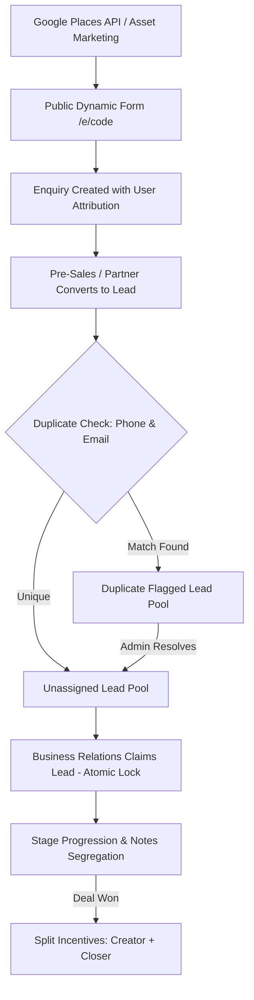

# Schoolites - Project Specification & Architecture Reference Document

## 1. Project Overview & True Scope
**Schoolites** is a specialized B2B Enterprise CRM and Multi-Actor Business Development Portal for educational software / ERP sales targeting educational institutions (Schools, Colleges, Universities, and Educational Organizations).

It is **NOT** an open educator monetization platform (that was an unrelated workspace rule from another project). 
Instead, Schoolites is a structured, production-grade B2B sales engine designed to acquire educational institutions through a coordinated pipeline of Pre-Sales outreach, Referral Partners, and Business Relations closers.

---

## 2. Actors & Role Responsibilities

### Actor 1: Root Administrator
* **User Management:** Create, deactivate, and monitor users across all 3 teams with sequential unique codes (`ADM-101`, `PS-102`, `REF-103`, `BR-104`).
* **Dynamic Form Configurator:** Toggle fields between Required, Optional, or Hidden for both Enquiry Forms and Lead Forms without code deploys.
* **Asset Hub:** Create and curate promotional assets (text, images, PDFs, video links) for marketing campaigns.
* **Incentive & Commission Governance:** Manage default payout rates (Pre-Sales 10%, Referral Partner 20%, Business Relations 10%), approve invoices, and record payouts with UTR/Transaction Reference IDs.
* **Lead Pool Oversight & Duplicate Resolution:** Central visibility into all leads, reassignment authority, and duplicate flag clearing.
* **Audit & Compliance Logs:** Full immutable audit trail recording every login, status change, claim, and administrative action.
* **Places Data Staging:** Execute Google Places API (New) searches and release curated batches to teams.

### Actor 2: Pre-Sales Team (`PS-xxx`)
* **Outreach & Unique Links:** Access marketing assets with unique shareable links (`/e/PS-xxx`) to drive organic institute enquiries.
* **Enquiry Management:** Access incoming enquiries submitted through their unique links.
* **Lead Conversion:** Qualify prospects and convert validated enquiries into official Leads in the unassigned pool.
* **Direct Lead Creation:** Enter qualified leads with full SPOC and Decision Maker information.
* **Incentive Tracking:** Track earned and pending 10% incentives upon deal closure by Business Relations.

### Actor 3: Referral Partner (`REF-xxx`)
* **Partner Hub & Unique Links:** Dedicated workspace with personal referral link (`/e/REF-xxx`).
* **Lead Submission:** Submit direct institute referrals.
* **Commission Tracking:** Track 20% commission rates on closed business.
* **Invoice Submission:** View pending/cleared commissions and submit billing invoices for Admin payment clearance.

### Actor 4: Business Relations Team (`BR-xxx`)
* **Unassigned Leads Pool:** Browse new leads created by Pre-Sales and Referral Partners.
* **Atomic Lead Claiming ("Grab"):** First-come-first-served atomic claim mechanism with HTTP 409 conflict handling to prevent double claims.
* **Deal Progression:** Manage assigned leads through stages (*New -> Contacted -> Presentation -> Proposal Sent -> Won / Lost*).
* **Dual-Tier Notes:**
  * **Private Notes:** Strictly confidential to the claiming manager (+ Admin).
  * **Public Remarks:** Global remarks visible to the lead's creator (Pre-Sales or Referral Partner).
* **Reassignment Authority:** Only the current assigned manager or an Admin can reassign a lead to another rep.

---

## 3. Data Pipeline & Lifecycle

---

## 4. Default Field Specifications

### Dynamic Enquiry Form (`/e/[code]`)
* **SPOC / Contact Info:** Name\*, Phone Number\*, Email
* **Institute Info:** Type\* (School, College, Institution, University, Other), Name of Org\*, Country\*, City, Student Count, Website, Message

### Lead Qualification Form
* **Institute Info:** Type\*, Name\*, Country\*, City\*, Student Strength\*, Current ERP\* (Yes / No / Unsure - if yes, which one)
* **Contact Details:**
  * **SPOC\*:** Name, Role/Designation, Mobile/WhatsApp, Email
  * **Decision Maker\*:** Name, Role/Designation, Mobile/WhatsApp, Email (checkbox to copy SPOC)
  * **Additional Contact:** ERP Admin / IT Head info
* **Decision Flow:** Multiline text input
* **Preferred Connect Slot:** Date, Time, Mode (Call / Meeting)
* **Additional Details**

---

## 5. Security & Business Logic Rules

1. **Dual Credit on Won Deals:** When a deal closes successfully, both the **Owner** (Pre-Sales or Referral creator) and the **Manager** (Business Relations closer) receive their respective incentive percentages.
2. **Atomic Grab:** Concurrent claims on the same lead use database-level transactional locks (`WHERE assigned_manager_id IS NULL`) to ensure only one user wins.
3. **Duplicate Detection:** Automatic matching on SPOC Phone Number and Email. Flagged leads remain visible to all parties, but prompt an Admin review action to prevent commission disputes.
4. **Action Confirmation Modals:** Every sensitive action (deactivating a user, claiming a lead, reassigning, resolving duplicates) requires explicit user confirmation.
5. **Session & Auth:** Custom secure JWT session cookies with 6-digit email OTPs. Dev mode provides local OTP auto-fill for testing.

---

## 6. Implementation Status

| Phase | Description | Status |
| :--- | :--- | :--- |
| **Phase 1** | Neon PostgreSQL schema, connection pooling, custom OTP auth | ✅ Complete |
| **Phase 2** | Root Admin portal: User management, dynamic form configurator, audit logs, database inspector | ✅ Complete |
| **Phase 3** | Marketing Asset Hub, public enquiry pages (`/e/[code]`), Pre-Sales & Referral Partner workspaces | ✅ Complete |
| **Phase 4** | Business Relations workspace, atomic lead claiming, note segregation, duplicate detection engine | ✅ Complete |
| **Asset Storage Upgrade** | Neon Object Storage (`storage-bucket`): 5MB image/PDF uploads, subfolder structure (`assets/${assetId}/`), video links, asset editing, and automated bucket folder cleanup | ✅ Complete |
| **Partner Workspace Alignment** | Synchronized Pre-Sales and Referral Partner asset views with Admin (inline carousels, lightbox zoom, monospace body text copy, single/all download prompts) | ✅ Complete |
| **Version Control Sync** | Connected to GitHub (`https://github.com/rizwanrko77/schoolites-crm.git`) on `main` branch with strictly ignored `.env.local` | ✅ Complete |
| **Phase 5** | Google Places API (New) integration with strict field masking, staging deduplication, and batch lead release | ⏳ Ready to build |
| **Phase 6** | Deal settlement & bank UTR reference tracking in `/admin/incentives` | ⏳ Ready to build |

